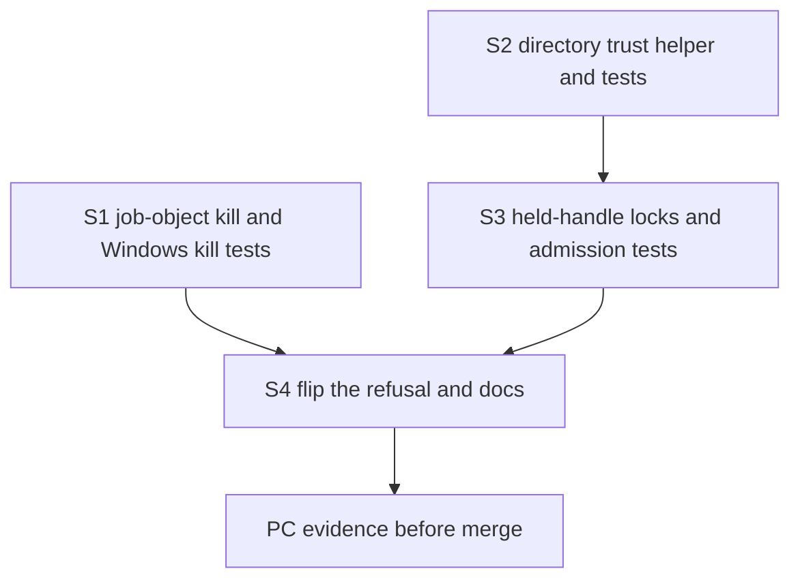

# Windows ticket admission and process-tree kill

Status: design only, no code. It answers decision D4 of [v0.2.md](v0.2.md) (line 250: "Separate design later, or pulled into this scope?", proposal "Separate design"). It changes no behavior and commits to no implementation. Written on 2026-11-16 against `origin/main` at commit `47aedd8`. Every `file:line` reference is to that commit.

## Answer in brief

- Today Windows admission is refused before the filesystem is touched (`tickets.py:111-119`, called first at `tickets.py:749`). The POSIX code cannot be ported line by line: it uses `os.geteuid` (`tickets.py:238,309,388,597`), `flock` (`tickets.py:599`), descriptor-relative opens (`tickets.py:96-103`), mode bits (`tickets.py:311-318`) and `os.kill(pid, 0)` (`tickets.py:572`). On Windows `os.kill(pid, 0)` terminates the process (Python `os` documentation, see Evidence), so the recovery probe would kill the lock owner.
- On timeout and cancel, Windows kills only the runner, not its children (`nisi.py:453-460`, `SECURITY.md:165-166`). The Node runner starts `node --check` and the Python checker (`nisi_runner.mjs:65,93`), so a kill of the runner alone can leave those children running.
- Recommendation for the ticket store: **Option A, held-handle locks**. Each lock is a file created with `CREATE_NEW` and kept open with a share mode that denies delete and write by others and with `FILE_FLAG_DELETE_ON_CLOSE`. The operating system closes the handle when the owner dies, so the lock disappears with it. There is no PID probe, no identity key and no 60 second wait on Windows. A leftover file after a power loss is detected by trying to open it for delete with no sharing.
- Recommendation for the kill: **Option K1, one Job Object per run** with `JOB_OBJECT_LIMIT_KILL_ON_JOB_CLOSE`, `TerminateJobObject` on timeout and cancel, and the job handle closed when the server exits. This also covers a server that is itself killed with `TerminateProcess`, which no signal handler can (`__main__.py:75-93`). `taskkill /T` is an optional fallback (K3). A console `CTRL_BREAK_EVENT` step (K2) is not recommended.
- The two parts are independent. The kill is the more urgent one: it fixes a gap that exists today for runs without a ticket. Admission stays refused until the tests in the Tests section pass on a real Windows host.
- Nothing here was run on Windows. This session used a Mac. Every Windows API statement is labeled as from documentation or from general knowledge, and all of it is unverified on hardware. See NOT_RUN.

## How claims are labeled

- `[code file:line]`: read in this checkout at `47aedd8`.
- `[doc: page]`: read this session from the named page (listed under Evidence). The page text, not a run, is the source.
- `[general]`: general platform knowledge whose page was not read this session. Treat as a hypothesis.
- `[unverified-hw]`: any claim about runtime behavior on Windows. Every Windows behavior claim in this document carries this label implicitly, because no Windows host was available. It is repeated where a design choice depends on it.

## What was read

Repository, at `47aedd8`: [v0.2.md](v0.2.md), `README.md`, `SECURITY.md`, `AGENTS.md`, `CHANGELOG.md`, `roadmap.md`, `src/agiw_mcp/tickets.py`, `nisi.py`, `config.py`, `__main__.py`, `rpc.py` (cancellation, lines 246-262), `nisi_runner.mjs` (lines 5-16, 40-100), `.github/workflows/ci.yml`, and the ticket, stale-lock and run-boundary tests named below.

Evidence, microsoft and python documentation fetched on 2026-11-16 (each through the web-fetch tool, which returns the page converted to Markdown):

- `learn.microsoft.com/en-us/windows/win32/api/jobapi2/nf-jobapi2-setinformationjobobject` (SetInformationJobObject)
- `learn.microsoft.com/en-us/windows/win32/api/winnt/ns-winnt-jobobject_basic_limit_information` (limit flags)
- `learn.microsoft.com/en-us/windows/win32/api/jobapi2/nf-jobapi2-assignprocesstojobobject` (AssignProcessToJobObject)
- `learn.microsoft.com/en-us/windows/win32/procthread/job-objects` (Job Objects)
- `learn.microsoft.com/en-us/windows/win32/procthread/process-creation-flags` (Process Creation Flags)
- `learn.microsoft.com/en-us/windows/console/generateconsolectrlevent` (GenerateConsoleCtrlEvent)
- `learn.microsoft.com/en-us/windows/win32/api/fileapi/nf-fileapi-createfilew` (CreateFileW)
- `learn.microsoft.com/en-us/windows/win32/api/fileapi/nf-fileapi-lockfileex` (LockFileEx)
- `learn.microsoft.com/en-us/windows/win32/api/winbase/nf-winbase-replacefilew` (ReplaceFileW)
- `learn.microsoft.com/en-us/windows/win32/api/aclapi/nf-aclapi-getsecurityinfo` (GetSecurityInfo)
- `learn.microsoft.com/en-us/windows-server/administration/windows-commands/taskkill` (taskkill)
- `docs.python.org/3/library/subprocess.html`, `msvcrt.html`, `signal.html`, `os.html` (the `os` page was read in three parts; `os.geteuid` was not found in the parts read, so its availability is `[general]`)

Not read: the pages for `GetFileInformationByHandleEx`, `GetFinalPathNameByHandleW`, `ConvertStringSecurityDescriptorToSecurityDescriptorW`, `SetSecurityInfo`, `GetAce`, `GetTokenInformation`, `OpenProcess`, `GetProcessTimes`, `TerminateJobObject`, `QueryInformationJobObject` and `GetDriveTypeW`. Calls to them below are `[general]` until read.

## Current behavior

### Tickets

- Admission is refused on Windows with `TICKET_UNSUPPORTED_PLATFORM` before any filesystem access, by either `os.name == "nt"` or `sys.platform == "win32"` (`tickets.py:111-119`; `admit` calls it first at `tickets.py:749`). `README.md:89` and `README.md:303` say the same. A run with no ticket still works unless `require_ticket` is true (`README.md:89`, `nisi.py:667-675`).
- The refusal message names "reparse-point, ownership and permission check", and a test pins that wording (`tests/test_tickets.py:178-200`, assertion at line 200). Any implementation lane edits that test on purpose.
- The ticket and stale-lock tests are skipped on Windows (`tests/test_tickets.py:20-23`, `tests/test_stale_locks.py:20-23`; `CHANGELOG.md:47`).
- A lock is a file created with `O_CREAT|O_EXCL` and mode 0600 (`tickets.py:626-644`). The file name is `scope-` plus the SHA-256 of the canonical scope (`tickets.py:223-224`), so no ticket id or scope text becomes a file name. Admission first creates `admit.lock` the same way and retries for `ADMIT_WAIT_SECONDS = 2.0` (`tickets.py:78,718-742`), checks every held scope for overlap, creates one lock per scope, and removes all of them on any failure (`tickets.py:772-811`). Release unlinks the names it created, through the directory descriptor kept since admission (`tickets.py:813-838`).
- The directory is reached by a descriptor walk from `/`: each directory must be owned by root or the effective user and not group or other writable unless sticky; each symlink must be owned likewise; the state directory must be a real directory owned by the effective user with mode 0700 (`tickets.py:237-319`, `322-356`). Where descriptor operations are missing, the code falls back to `ensure_private_dir`, which only calls `mkdir` and `chmod` (`tickets.py:328-330`, `config.py:343-351`). The comment at `tickets.py:322-327` says Windows never gets there.
- Recovery needs a keyed machine identity (`identity.key`, mode 0600, `tickets.py:395-469`), a host identity that exists only for Linux and macOS (`tickets.py:472-499`; other platforms return `None`, which makes `_dead_owner` return false at `tickets.py:553-556`), a process start identity for Linux and macOS (`tickets.py:502-534`), a 60 second minimum age (`tickets.py:80,563`), a PID probe with `os.kill(pid, 0)` (`tickets.py:572`) and `flock` on the candidate inode (`tickets.py:588-599`). If `fcntl` is missing, recovery returns false (`tickets.py:84-87,588`). So on Windows today recovery is inert twice over. A crashed run's locks would never be reclaimed.
- Incomplete lock writes need manual cleanup (`SECURITY.md:279`); a stranded `admit.lock` after a crash is the same case in the design's reading, which the code at `tickets.py:718-742` supports but SECURITY.md does not state.
- The documented trust limits: ticket exclusion is cooperative (`tools.py:49`), and same-user forging of ticket records is out of scope (`SECURITY.md:202`, `205`).

### Process launch and kill

- The runner starts with `subprocess.Popen` and `start_new_session=True` on POSIX only. A comment says `CREATE_NEW_PROCESS_GROUP` "can make CreateProcess fail on Windows" (`nisi.py:517-523`). That comment is an unverified claim in the code; this document does not rely on it.
- `_kill_tree` calls `os.killpg(proc.pid, SIGKILL)` on POSIX and `proc.kill()` elsewhere (`nisi.py:453-460`). The Python documentation says `Popen.kill()` on Windows is an alias for `terminate()`, which calls `TerminateProcess()` `[doc: subprocess]`. It ends one process, not its children.
- `_kill_tree` runs on output overflow (`nisi.py:543`) and in the `finally` of the wait loop for timeout, cancellation and any exception (`nisi.py:572-595`). Timeout is the request timeout plus 30 seconds (`nisi.py:818`, `request["timeout"] + 30`). Cancellation sets a per-request event (`rpc.py:246-257`) that the wait loop polls every 0.1 second (`nisi.py:572-578`).
- The runner reads all of stdin before it does anything else (`nisi_runner.mjs:40-48`), and starts children with `spawnSync` only inside the syntax checks (`nisi_runner.mjs:65,93`), each with a 15 second timeout (`nisi.py:784`). The server starts the stdin writer thread after `Popen` (`nisi.py:552-569`).
- Server shutdown: SIGTERM and SIGHUP handlers unwind the run's `finally` blocks (`__main__.py:75-93`). SIGHUP is looked up with `getattr` (`__main__.py:82`), so it is skipped on Windows. Python allows `signal.signal(SIGTERM)` on Windows `[doc: signal]`, but that page does not say when Windows delivers it. A parent that ends the server with `TerminateProcess` runs no handler `[general]`. `SECURITY.md:203` lists uncatchable termination as out of scope.
- The documented gap: "On timeout, agiw-mcp kills the process group on POSIX and only the runner process on Windows" (`SECURITY.md:165-166`; `CHANGELOG.md:69` says cleanup runs on handled signals).
- The kill tests are POSIX only: `tests/test_nisi_boundaries.py:17` skips the class unless `os.name == "posix"`, and the grandchild test uses `sleep`, `SIGKILL` and `os.kill(pid, 0)` (`tests/test_nisi_boundaries.py:31-60`); `tests/test_nisi.py:255` also depends on a shebang fake runner. No test exercises a Windows kill path.
- CI: the `windows` job runs scrub, compile and unit tests on Python 3.12 and Node 22 (`ci.yml:191-215`). Same-repo events use the self-hosted `pc-win` runner; fork pull requests use `windows-latest` (`ci.yml:194`, `AGENTS.md:67-68`). So a test written for "windows-latest" also runs on the PC for same-repo events.

## Requirements

- R1. Refuse any ticket state directory whose path or ancestors can be redirected, replaced or written by another principal. Fail closed with `TICKET_REGISTRY_UNSAFE`.
- R2. All-or-none admission across scopes, with the same overlap rule and error codes as POSIX (`tickets.py:772-811`).
- R3. A crashed server must not strand locks, or the stranded lock must be reclaimable without trusting a PID.
- R4. The identity of the state directory is fixed at admission and release touches only that directory (`tickets.py:813-838`).
- R5. On timeout, cancel, output overflow and server exit, the runner and everything it started are terminated, and the call returns only after that is observed or bounded by a deadline.
- R6. No runtime dependencies (`AGENTS.md:91`): only `ctypes`, `msvcrt` and the standard library, on Python 3.10 or newer (`README.md:9`).
- R7. No raw machine identifiers, SIDs or paths in refusals or logs, as on POSIX (`tickets.py:48`, `tickets.py:611`).

## Threat model on Windows

Who can do what, assuming the design below. All of it is `[unverified-hw]`.

| Attacker | Can | Cannot, with the design |
|---|---|---|
| Another standard local user | Create directories and, in a folder they can write, create junctions (and symlinks if they hold the symlink privilege or developer mode `[general]`); pre-create files at a predictable shared path such as an `AGIW_MCP_TICKET_DIR` outside the user profile; hold files open to cause sharing violations (denial of service) | Swap an ancestor for a junction after the walk: the walk pins every ancestor handle until release. Read lock records inside a protected private directory. Delete or rename a held lock: its share mode excludes delete. |
| Same user, another process | Everything the user can: terminate the server, edit the directory's DACL, call `DuplicateHandle` with `DUPLICATE_CLOSE_SOURCE` on the server's handles and so release a lock or the job early `[general]`, forge records | Nothing is claimed. This is the existing boundary: cooperative exclusion (`tools.py:49`) and same-user forging out of scope (`SECURITY.md:202`). |
| Administrator or SYSTEM | Anything | Out of scope, as a compromised local account (`SECURITY.md:205`). Their SIDs are trusted owners on ancestors, as root is on POSIX (`tickets.py:238`). |
| Security software, indexers, backup, cloud sync | Open files briefly without the share modes we want | Cause a wrong admission. They can cause a spurious refusal or a short `TICKET_REGISTRY_BUSY`; the design treats every sharing violation as "held". |
| A remote or redirected profile | Make `%APPDATA%` a network share, where share modes and ACLs may differ | Be trusted. The design refuses non-local state directories. |

Not defended: an attacker with the same token, a kernel-level attacker, and hostile model output reaching the runner (that is the Nisi sandbox's job, `SECURITY.md:105-111`).

## Part 1: ticket store and admission

### Common to both options: trusting the directory

The POSIX owner and mode checks map to these checks. The directory half of the work is the same in both options.

1. State directory location. `state_dir()` (`tickets.py:213-220`) uses `config_dir() / "tickets"`, and on Windows `config_dir()` is under `%APPDATA%` (`config.py:99-101`), the roaming profile. See open decision W1. The path must be absolute; reject UNC paths, `\\?\` device paths and non-fixed drives (W2).
2. Walk. POSIX opens each component with `O_NOFOLLOW` relative to the parent descriptor. Python on Windows has no `openat`. The Windows walk opens each prefix of the path in order and keeps every handle open until release:
   - `CreateFileW(prefix, FILE_LIST_DIRECTORY | READ_CONTROL, FILE_SHARE_READ | FILE_SHARE_WRITE, NULL, OPEN_EXISTING, FILE_FLAG_BACKUP_SEMANTICS | FILE_FLAG_OPEN_REPARSE_POINT, NULL)`. `[doc: CreateFileW]` says `FILE_FLAG_BACKUP_SEMANTICS` is required to obtain a directory handle, and that with `FILE_FLAG_OPEN_REPARSE_POINT` normal reparse processing does not occur and the handle is to the link itself.
   - `GetFileInformationByHandleEx(handle, FileAttributeTagInfo, ...)`: refuse if `FILE_ATTRIBUTE_REPARSE_POINT` is set on any component, whatever the tag (symlink, junction, mount point, cloud placeholder). `[general]`
   - `GetFinalPathNameByHandleW`: compare the final path with the requested prefix, case-insensitively, to catch short-name and subst aliases. `[general]`
   - The share mode omits `FILE_SHARE_DELETE`, so no process can open the directory with delete access, which renaming or removing it requires. `[doc: CreateFileW]` says that without `FILE_SHARE_DELETE` no process can open a file or device that requests delete access. Whether NTFS also blocks renaming an ancestor that has an open descendant handle is `[unverified-hw]`; holding a handle on every ancestor avoids relying on that.
   - Failure modes: path longer than `MAX_PATH` without the `\\?\` prefix; an ancestor that denies `READ_CONTROL` (the call fails; refuse); a drive root, which has no reparse point but a special owner.
3. Owner and ACL of each directory. For each handle: `GetSecurityInfo(handle, SE_FILE_OBJECT, OWNER_SECURITY_INFORMATION | DACL_SECURITY_INFORMATION, &owner, NULL, &dacl, NULL, &sd)` `[doc: GetSecurityInfo]`, which needs `READ_CONTROL` on the handle and a `LocalFree` of the descriptor. Then:
   - Owner must be one of: the current user SID (`GetTokenInformation(TokenUser)`), the token's default owner (`TokenOwner`, which is `BUILTIN\Administrators` for an elevated token `[general]`), `BUILTIN\Administrators` (`S-1-5-32-544`), `SYSTEM` (`S-1-5-18`), or `NT SERVICE\TrustedInstaller`. This is the analog of "owned by root or the effective user" (`tickets.py:238`).
   - No allow ACE (`GetAce`, `ACCESS_ALLOWED_ACE_TYPE`) for any other SID may grant `DELETE`, `FILE_DELETE_CHILD`, `WRITE_DAC` or `WRITE_OWNER`. This is the analog of "not group or other writable" (`tickets.py:241-248`). Creating new children (`FILE_ADD_FILE`, `FILE_ADD_SUBDIRECTORY`) is allowed on ancestors, as on a sticky directory, because it cannot replace an existing entry. ACE types other than simple allow and deny are treated as unsafe. Deny ACEs are ignored, which can only refuse more. `[general]`
   - The state directory itself must additionally be owned by the current user SID (or the token owner) and have a protected DACL (the `SE_DACL_PROTECTED` control bit) with ACEs only for the user, `SYSTEM` and `BUILTIN\Administrators`. This is the analog of 0700 (`tickets.py:306-319`).
4. Creating or tightening. A new directory is created with `CreateDirectoryW(path, &sa)` where the descriptor comes from `ConvertStringSecurityDescriptorToSecurityDescriptorW("D:PAI(A;OICI;FA;;;<user-sid>)(A;OICI;FA;;;SY)(A;OICI;FA;;;BA)", SDDL_REVISION_1, &sd, NULL)`. `[general]` The tightening step that POSIX does with `fchmod` (`tickets.py:311-318`) becomes `SetSecurityInfo(handle, SE_FILE_OBJECT, DACL_SECURITY_INFORMATION | PROTECTED_DACL_SECURITY_INFORMATION, NULL, NULL, newDacl, NULL)` on a handle opened with `WRITE_DAC`, only when the current user owns the directory, followed by a re-read and the same checks. `[general]`
5. `os.chmod` and the `mode` argument of `os.open` do nothing useful: on Windows `os.chmod` changes only the read-only flag `[doc: os]`. The 0600 intent on files comes from inheriting the private directory DACL (`OICI` ACEs above). `[unverified-hw]`
6. Hard links: after opening a lock file, `GetFileInformationByHandle` `nNumberOfLinks` must be 1, the analog of `st_nlink == 1` (`tickets.py:597`). `[general]`

### Option A: held-handle locks (recommended)

The lock's lifetime is the lifetime of an open handle, not of a file name plus a PID record.

Create a lock (`admit.lock` or `scope-<hash>.lock`):

```
CreateFileW(path,
            GENERIC_READ | GENERIC_WRITE | DELETE,
            FILE_SHARE_READ,                       // no write, no delete for others
            &sa_private,                           // optional; the directory DACL is inherited
            CREATE_NEW,                            // ERROR_FILE_EXISTS (80) if present
            FILE_ATTRIBUTE_NORMAL | FILE_FLAG_DELETE_ON_CLOSE | FILE_FLAG_OPEN_REPARSE_POINT,
            NULL)
```

- `CREATE_NEW` fails with `ERROR_FILE_EXISTS` when the file exists `[doc: CreateFileW]`. That is the exclusive-create protocol, kept.
- `FILE_FLAG_DELETE_ON_CLOSE` deletes the file after all handles close, and later opens fail unless they pass `FILE_SHARE_DELETE` `[doc: CreateFileW]`. `FILE_FLAG_OPEN_REPARSE_POINT` makes a planted link be treated as the link, not its target `[doc: CreateFileW, Symbolic Link Behavior]`. Whether `DELETE_ON_CLOSE` requires `DELETE` access in the open call is `[general]`; the call above requests it.
- Write the record with `WriteFile` and `FlushFileBuffers` through the same handle. Keep the handle in the `_Admission` object in place of the name list (`tickets.py:675-681`).
- Release: `CloseHandle`. The file goes with it. There is no unlink by name, so the "directory swapped, leave locks" branch (`tickets.py:826-832`) is replaced by the pinned directory handles from the walk.
- Crash: the kernel closes the process's handles, the file is deleted, and the lock is gone. The `[doc: LockFileEx]` page notes that the time to release a byte-range lock after termination depends on system resources; the same caution applies here, and the design answers it with a retry inside the existing 2 second wait. `[unverified-hw]`

Read a held record (overlap check, under `admit.lock`):

```
CreateFileW(path, GENERIC_READ,
            FILE_SHARE_READ | FILE_SHARE_WRITE | FILE_SHARE_DELETE,
            NULL, OPEN_EXISTING, FILE_FLAG_OPEN_REPARSE_POINT, NULL)
```

- The reader must pass `FILE_SHARE_WRITE` because the holder holds write access, and `FILE_SHARE_DELETE` because of `DELETE_ON_CLOSE` `[doc: CreateFileW]`. Same size bound, regular-file check and `TICKET_REGISTRY_CORRUPT` rule as `tickets.py:647-664` and `692-716`.
- Records are written while the writer holds `admit.lock`, and read only by holders of `admit.lock`, so a reader never sees a half-written record.

Detect a stale file (after a power loss, or any file left by an older crash):

```
CreateFileW(path, GENERIC_READ | DELETE, 0 /* no sharing */, NULL,
            OPEN_EXISTING,
            FILE_FLAG_DELETE_ON_CLOSE | FILE_FLAG_OPEN_REPARSE_POINT, NULL)
```

- `ERROR_SHARING_VIOLATION` means a live holder: the file stays, admission is refused or retried. Success means no handle exists and the file is stale. Check `FileAttributeTagInfo` and the link count before closing; if it is a reparse point or has extra links, do not close with delete (refuse as corrupt). Otherwise `CloseHandle` deletes it. `[doc: CreateFileW]` states the share-mode and delete-on-close rules this relies on; whether the probe's handle can race with a new holder between open and close is bounded by `admit.lock` and is `[unverified-hw]`.
- This replaces `_dead_owner`, `_reclaim_stale`, `identity.key`, the host and process identities and the 60 second age on Windows. The `processOwner` field (`tickets.py:784,788`) is written with only `pid` and `createdAt` on Windows and is never used for recovery; no `identity.key` is created there (`tickets.py:537-544` would create one, so the Windows path does not call it).

`admit.lock` serialization: the same create call in a loop with `time.sleep(0.01)` until a deadline, as `tickets.py:718-742`. Because it is held-handle based, a crashed holder no longer strands it, which is better than POSIX (`SECURITY.md:279`).

Failure modes:

- A scanner or indexer holds a stale lock file open with a share mode that lacks `FILE_SHARE_DELETE`. The probe fails with a sharing violation and the lock is read as live: admission refuses or returns `TICKET_REGISTRY_BUSY` until it lets go. Fail closed.
- A handle count of about 64 locks, 1 admission lock and about 10 ancestor handles per admitted ticket (`MAX_SCOPES = 64`, `tickets.py:74`) is well below default per-process limits `[general]`.
- A server started in a job that forbids some handle operations is not expected to matter; not checked.
- A state directory on a network volume: share modes are honored by SMB `[general]`, but ACL semantics and the "closed on death" property depend on the server. Refused by W2.
- Spurious `ERROR_ACCESS_DENIED` from ACL inheritance, if the directory DACL was not applied as above: the create fails and admission returns `TICKET_REGISTRY_UNAVAILABLE`.
- Python callers must set `argtypes` and `restype` on every ctypes function, because the default `int` return truncates 64-bit handles. A wrapper class with `__del__` is not enough; handles are closed in `finally` as at `tickets.py:765-768`.

### Option B: port the POSIX scheme (exclusive create, PID records, reclaim lock)

Keep the file format and the recovery rules; replace only the OS calls.

- Create: `os.open(path, O_WRONLY|O_CREAT|O_EXCL)` or the `CreateFileW` call above without `DELETE_ON_CLOSE`. The `0o600` argument is ignored (see Common, item 5). The handle closes right after the write (`tickets.py:640`), so the file persists after the process dies.
- Host identity: read `MachineGuid` from `HKLM\SOFTWARE\Microsoft\Cryptography` (`RegGetValueW`) and HMAC it with `identity.key` as `tickets.py:377-382` does. `[general]`
- Process start: `OpenProcess(PROCESS_QUERY_LIMITED_INFORMATION, FALSE, pid)` then `GetProcessTimes` creation time. Liveness: `WaitForSingleObject(handle, 0)` or `GetExitCodeProcess` against `STILL_ACTIVE` (259). `OpenProcess` failing with `ERROR_INVALID_PARAMETER` means no such PID; `ERROR_ACCESS_DENIED` means alive but protected, which must be treated as live (the analog of `tickets.py:575-576`). `[general]`
- Never `os.kill(pid, 0)`: on Windows any signal other than `CTRL_C_EVENT` and `CTRL_BREAK_EVENT` "will cause the process to be unconditionally killed by the TerminateProcess API" `[doc: os]`.
- Reclaim serialization replaces `flock` (`tickets.py:599`). `msvcrt.locking` locks a byte range from the current position, retries `LK_LOCK` once a second for ten attempts, and `LK_NBLCK` makes one attempt `[doc: msvcrt]`; a single non-blocking try inside our own loop fits the 2 second budget better. `LockFileEx(handle, LOCKFILE_EXCLUSIVE_LOCK | LOCKFILE_FAIL_IMMEDIATELY, 0, nLow, nHigh, &overlapped)` is the underlying call and requires an `OVERLAPPED` with the offset `[doc: LockFileEx]`. Differences from `flock`: it is a byte-range lock, and a lock on a range denies other processes read and write access to that range `[doc: LockFileEx]`, so a reader hitting a locked range fails and `tickets.py:703-714` would report `TICKET_REGISTRY_CORRUPT`. The page says a lock beyond end of file is not an error, so lock a range past EOF (for example offset 2^32) to keep reads working. The lock also does not stop another process from deleting or renaming the file if it opened with `FILE_SHARE_DELETE`; the identity re-check at `tickets.py:607-609` stays necessary, using `(volume serial, file index)` from `GetFileInformationByHandle` in place of `(st_dev, st_ino)`.
- Deletion of a lock file by name with `os.unlink` fails while any other handle without `FILE_SHARE_DELETE` is open `[general]`; Python opens files with the C runtime share mode, which I expect not to include delete `[general]`. A reader open at that moment makes reclaim fail and return false (`tickets.py:620-621`), which is the safe direction.
- Failure modes: PID reuse (mitigated only by start time); unreadable `MachineGuid` disables recovery, which is fail closed; clock steps against the 60 second rule; all POSIX stranding behavior returns (see line 52 for the receipt); still needs the whole directory trust work in Common.

Option B keeps one on-disk format for both platforms and one recovery explanation in `SECURITY.md:263-274`. It costs a Windows host identity, a Windows process-start identity, a `LockFileEx` wrapper and the PID-reuse analysis, all of which Option A removes.

### Rejected: named kernel objects

A named mutex or event per scope (`CreateMutexW`) would release on death and need no files. It leaves no inspectable state, gives `TICKET_REGISTRY_CORRUPT` and the existing refusal tests nothing to check, and a name can be created first by another process in the same session so that we cannot open it `[general]`. Not pursued.

### Atomic create and replace

- Create is atomic with `CREATE_NEW`. Locks are written once and never replaced, so the ticket store needs no replace operation.
- Where a replace is needed (the identity key in Option B publishes through `os.link`, `tickets.py:453-465`; `write_private_json` uses `os.replace`, `config.py:354-376`): `os.replace` silently replaces an existing file if permitted and is atomic as a POSIX requirement `[doc: os]`. On Windows its atomicity and its behavior when the destination is open are not stated in what was read; `ReplaceFileW` opens the replaced file with all three share modes and can fail leaving partial states with error codes 1175, 1176 and 1177 `[doc: ReplaceFileW]`. Treat Windows replace as not guaranteed atomic. Config writes are outside this design and unchanged. `os.link` is available on Windows `[doc: os]`.

## Part 2: process-tree kill

All three options need `ctypes` (R6). Common to all: the kill result is awaited (`proc.wait(timeout=5)`, `nisi.py:591`) and the pipe readers are joined (`nisi.py:593-595`), as today.

### Option K1: Job Object per run (recommended)

Calls, in order:

1. `CreateJobObjectW(NULL, NULL)`: an unnamed job, so no other process can open it by name. `[general]`
2. `SetInformationJobObject(job, JobObjectExtendedLimitInformation, &info, sizeof(info))` with `info.BasicLimitInformation.LimitFlags = JOB_OBJECT_LIMIT_KILL_ON_JOB_CLOSE` (0x2000). `[doc: JOBOBJECT_BASIC_LIMIT_INFORMATION]` says this flag "causes all processes associated with the job to terminate when the last handle to the job is closed" and needs the extended limit structure. Set neither `JOB_OBJECT_LIMIT_BREAKAWAY_OK` nor `JOB_OBJECT_LIMIT_SILENT_BREAKAWAY_OK`: `[doc: Job Objects]` lists "prevent breakaways" as the way to monitor a whole tree, with the note that a child's own `AssignProcessToJobObject` calls then fail.
3. `subprocess.Popen(argv, ..., creationflags=0)` as today. Then `AssignProcessToJobObject(job, int(proc._handle))` (the Python process handle has the access rights the call needs `[general]`; the documented requirement is `PROCESS_SET_QUOTA` and `PROCESS_TERMINATE` `[doc: AssignProcessToJobObject]`). Do this before the writer thread starts (`nisi.py:563-569`). The runner reads stdin to EOF before it starts any child (`nisi_runner.mjs:40-48`, spawns at `65,93`), and stdin is closed only by that thread, so no grandchild can exist before assignment. This avoids `CREATE_SUSPENDED`, which `subprocess` does not resume for us.
4. Kill on timeout, cancel and overflow: `TerminateJobObject(job, 1)` `[general]`, then `CloseHandle(job)`. Closing alone also kills, because of the flag. `[doc: Job Objects]` says closing the last handle of a job with the flag terminates all associated processes and then destroys the job.
5. Verify: `QueryInformationJobObject(job, JobObjectBasicAccountingInformation, ...)` and poll `ActiveProcesses == 0` within the existing 5 second budget. `[general]`
6. Server exit by any route, including `TerminateProcess` of the server: the job handle belongs to the server process, so its closure by the system ends the tree. `[doc: Job Objects]` plus `[unverified-hw]`.

Failure modes:

- `AssignProcessToJobObject` can fail if the child is already in a job that cannot nest. Windows 8 and Windows Server 2012 added nested jobs; before that the call fails with `ERROR_ACCESS_DENIED` `[doc: AssignProcessToJobObject]`. The child is new, so it is normally in the server's own job if the MCP client placed the server in one; with nesting that is allowed. Decision W3 covers a failed assignment: this design recommends refusing the run (kill the child, return an error) rather than running unprotected.
- A grandchild created with `CREATE_BREAKAWAY_FROM_JOB` escapes only if a job in the chain permits breakaway `[doc: Process Creation Flags; Job Objects]`. We set neither flag. If the client's outer job permits breakaway, our inner job still does not.
- The job is per run and lives in the server process; the 16 other queued messages are unaffected (`README.md:307`).
- A same-user process that can duplicate-close the job handle kills the run early. Denial of service by the same user, out of scope.
- 64-bit handles: `int(proc._handle)` is a private attribute of `Popen`; the alternative is to open the pid with `OpenProcess(PROCESS_SET_QUOTA | PROCESS_TERMINATE, ...)`. Both work; the second avoids a private attribute at the price of a PID reuse window of microseconds. `[general]`

### Option K2: new process group and `CTRL_BREAK_EVENT`

- `Popen(..., creationflags=subprocess.CREATE_NEW_PROCESS_GROUP)`, then `proc.send_signal(signal.CTRL_BREAK_EVENT)` (Python: only for processes started with that flag `[doc: subprocess]`), which calls `GenerateConsoleCtrlEvent(CTRL_BREAK_EVENT, proc.pid)`.
- `[doc: Process Creation Flags]`: the new process is the root of a process group, and `CTRL+C` is disabled for processes in it. `[doc: GenerateConsoleCtrlEvent]`: only processes in the group that share the caller's console receive the signal, and a process that creates a new console does not. An MCP server launched by a desktop client typically has no console `[general]`, so the call may fail or reach nothing.
- It is a polite request: the handler decides, and a child in the group can ignore it. The POSIX path never asks politely (`SIGKILL`, `nisi.py:456`), so K2 adds a state and no guarantee. It also does not cover a server that dies.
- The code comment at `nisi.py:517` claims the flag can make process creation fail. I could not confirm that.
- Not recommended as the kill. It could be a first step before K1 if a graceful runner exit is ever wanted. Not needed today.

### Option K3: `taskkill /PID <pid> /T /F`

- `[doc: taskkill]`: `/T` "ends the specified process and any child processes started by it" and `/F` forces it.
- Use the absolute path under the system directory (not `PATH`: the runner's environment has none of it, `nisi.py:609-622`, and the server's `PATH` is not a trust anchor).
- Failure modes `[general]`: the parent-child chain is read at call time, so a child whose parent already exited is missed; the PID can be reused between the decision and the call; it starts another process while the server is in the middle of a timeout; it does nothing when the server dies. It can finish a tree only as a fallback after K1 assignment failure, if W3 chooses fallback over refusal.

## Recommendation

- Store: Option A, with the directory work in Common, in one module section guarded by `os.name == "nt"`, in `tickets.py` or a new `tickets_windows.py`. The POSIX functions stay unchanged; the error codes and refusal texts stay the same, except `TICKET_REGISTRY_UNSAFE` whose message names "mode 0700" and must become platform aware (`tickets.py:227-234`).
- Kill: Option K1. K3 only if W3 is answered "fallback".
- Keep `TICKET_UNSUPPORTED_PLATFORM` for a Windows host that fails the capability probe (ctypes missing, a function absent, a non-NTFS state volume). It is not removed.
- Order of work, one concern per pull request:



  Arrows mean "must land before". S1 does not depend on tickets. S4 changes `README.md:80,89,303`, `SECURITY.md:165-166,263-279`, `AGENTS.md:79-80,172-173`, the `ci.yml` job name text, `CHANGELOG.md` and `roadmap.md:21`, and removes the three Windows skips and the refusal test (`tests/test_tickets.py:20-23,178-200`, `tests/test_stale_locks.py:20-23`).

## Tests that would pin it

Tag: H = can run on a GitHub-hosted `windows-latest` runner (and on the `pc-win` runner, since same-repo events go there, `ci.yml:194`). P = needs a real PC with a second account or special setup. All are written against the pinned design; none has been run.

| Id | What it pins | Where |
|---|---|---|
| T1 | `_kill_tree` equivalent ends a runner and a grandchild (a Python child that starts `ping -n 30 127.0.0.1` or another Python) on timeout, cancel and overflow; `ActiveProcesses == 0` afterwards. Windows twin of `tests/test_nisi_boundaries.py:31-60`. | H |
| T2 | Killing the server process with `Popen.kill()` (a test harness parent) ends the runner tree through the closed job handle. | H |
| T3 | A grandchild started with `CREATE_BREAKAWAY_FROM_JOB` does not escape (job has no breakaway flag), or fails to start; either outcome is recorded. | H |
| T4 | Assignment failure path: server started inside an outer job without nesting-friendly flags, if reproducible; else mocked failing `AssignProcessToJobObject` returns the chosen error and leaves no child. | H (mock) / P (real) |
| T5 | Two processes race `CREATE_NEW` on one name: exactly one wins. Repeat with 8 processes and 200 rounds. | H |
| T6 | Holder killed with `TerminateProcess`: the lock file disappears and the next admission succeeds with no wait beyond the retry window. | H |
| T7 | Stale file with no holder (created without delete-on-close and left behind, simulating a power loss) is reclaimed by the share-mode probe; a held file is not. | H |
| T8 | Probe on a file held open by a scanner-like process without `FILE_SHARE_DELETE` reads as live and admission refuses; no deletion. | H |
| T9 | All-or-none: 64 scopes with one conflicting scope leaves no lock file and no handle. Overlap, `holder == ticket_id` and case rules equal the POSIX tests. | H |
| T10 | Junction at the state directory (`mklink /J`) is refused with `TICKET_REGISTRY_UNSAFE`; junction at an ancestor is refused; a directory symlink is refused when the account may create one, otherwise the test skips. | H (junction) / H or P (symlink) |
| T11 | A lock path replaced by a junction or symlink is not followed or deleted (open-reparse behavior). | H |
| T12 | Hard link to a lock file is refused (link count 2). | H |
| T13 | Directory owner and DACL checks against fabricated cases: extra allow ACE for `Users` with `DELETE`, unprotected DACL, owner other than the user. Tighten succeeds for the user's own directory and the result re-verifies. | H |
| T14 | A second local standard user cannot open, delete or rename the state directory or a held lock; a pre-created directory owned by that user is refused. | P |
| T15 | Elevated and non-elevated tokens: owner is accepted in both, and the lock files created by one are read by the other only when it is the same user. | P |
| T16 | `AGIW_MCP_TICKET_DIR` on a UNC path, a mapped drive and a `\\?\` path is refused. A path with 8.3 short names and different case resolves to one identity. | H (path forms) / P (network) |
| T17 | `os.kill(pid, 0)` is never called under `os.name == "nt"` (mock it to fail the test). | H |
| T18 | `TICKET_UNSUPPORTED_PLATFORM` capability probe: missing function or non-NTFS volume refuses before the filesystem is touched, as `tests/test_tickets.py:178-200` does today. | H |
| T19 | End to end: `agiw_nisi_run` with a ticket and a fake Windows runner (a `.cmd` or Python wrapper, since the POSIX shebang fake does not work, `tests/test_nisi.py:122`), timeout and cancel release the ticket and end the tree. | H |
| T20 | Server launched by a GUI client (no console), cancel and server shutdown through the client. | P |

Linux and macOS tests must pass unchanged: the Windows code is behind `os.name == "nt"` and the POSIX paths are not edited.

## NOT_RUN

Everything about Windows behavior. This session ran on macOS; no Windows host, VM or CI run was used, and no job, share-mode, ACL, reparse or console call was executed. In particular, none of the following is established: share-mode conflicts with Defender, search indexing or backup tools; whether closing a process's handles at `TerminateProcess` deletes `DELETE_ON_CLOSE` files promptly; ancestor rename behavior with open descendant handles; `TokenOwner` for elevated tokens; ACL inheritance of the SDDL above; junction and symlink creation rights on the target account; nested-job assignment inside each supported MCP client's launcher; `CREATE_NEW_PROCESS_GROUP` behavior with Node; handle counts; `os.replace` atomicity on Windows; and every ctypes signature and structure layout. The microsoft and python pages listed under Evidence were read, but a documentation page is not a test.

Also not run: any code from this document, the Windows CI job, and the SMB, redirected-profile and network-volume cases.

## Open decisions, with recommended answers

| Id | Question | Recommendation |
|---|---|---|
| W1 | Where does ticket state live on Windows? It is under `%APPDATA%` (roaming) today via `config_dir()` (`config.py:99-101`). | `%LOCALAPPDATA%\agiw-mcp\tickets`. Lock files must not roam. `AGIW_MCP_TICKET_DIR` keeps overriding. |
| W2 | Are UNC, `\\?\` device, mapped and removable-drive state directories allowed? | Refuse unless the volume is a local fixed drive (`GetDriveTypeW == DRIVE_FIXED` `[general]`). Message names the rule, not the path. |
| W3 | If assignment to the job fails, refuse the run, fall back to `taskkill /T`, or run unprotected? | Refuse the run and kill the child. Add no config key until a real client shows the failure. Revisit with T4 and T20 evidence. |
| W4 | Accept an owner of the current user SID only, or also the token's default owner? | Both, plus `Administrators`, `SYSTEM` and `TrustedInstaller` on ancestors only. |
| W5 | Minimum Windows version? | Windows 10 or newer for this feature (nested jobs need 8 or newer `[doc: AssignProcessToJobObject]`). Older refuses with `TICKET_UNSUPPORTED_PLATFORM`; the kill code refuses the run. |
| W6 | Dependencies: `ctypes` or `pywin32`? | `ctypes` only (`AGENTS.md:91`). |
| W7 | When does the refusal flip? | In the same pull request that adds the passing P-tagged evidence, not before. No opt-in key and no preview flag. |
| W8 | Use `CTRL_BREAK_EVENT` as a graceful step? | No (K2). |
| W9 | New error codes? | None for admission: reuse `TICKET_REGISTRY_UNSAFE`, `_BUSY`, `_UNAVAILABLE`, `_CORRUPT`, `TICKET_SCOPE_CONFLICT`. One new code for a refused unprotected run (W3) is the only candidate. |
| W10 | Who approves starting the implementation lanes? | The owner. This document is the "separate design" that proposal D4 asked for (`v0.2.md:250`); `v0.2.md:267` records D3 to D5 as not decided, so the owner still answers D4 before step S1 starts. |
